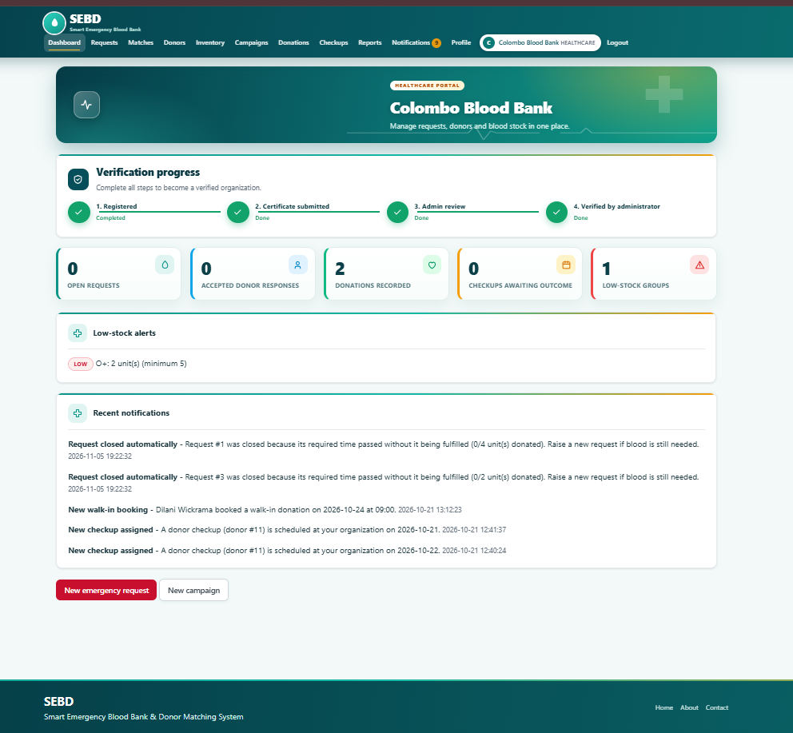
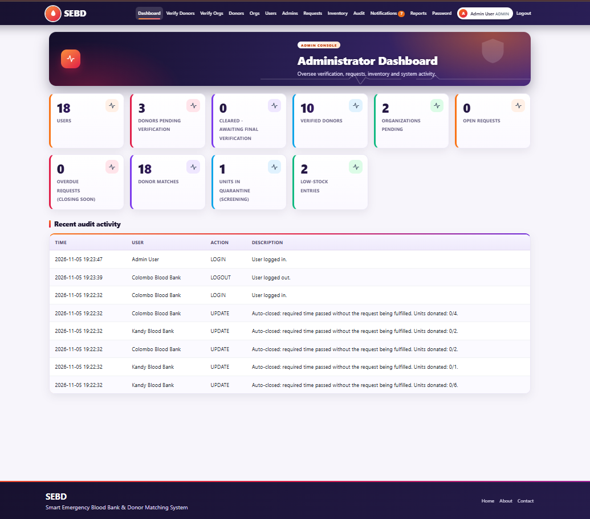
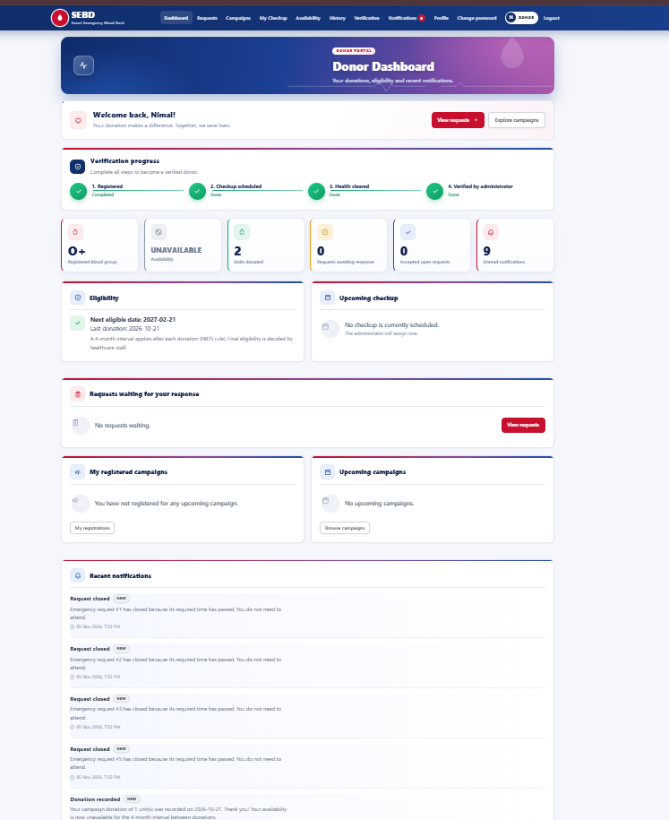

# Smart Emergency Blood Bank & Donor Matching System (SEBD)

## Project Overview

The Smart Emergency Blood Bank & Donor Matching System (SEBD) is a web-based application designed to support emergency blood donation management by connecting blood donors, patients, and healthcare organizations.

The system provides dedicated interfaces for donors, healthcare organizations, and administrators to manage donor information, blood requests, donation activities, and related operations.

## Key Features

### Donor Management
- Donor registration and authentication.
- Donor profile management.
- Donation information management.
- Donor verification and eligibility-related information.
- Donation campaign information.

### Healthcare Organization Management
- Healthcare organization registration and management.
- Organization dashboard.
- Emergency blood request management.
- Blood stock monitoring and alerts.
- Donation and request-related notifications.

### Administrator Management
- Centralized administration dashboard.
- User and donor management.
- Healthcare organization verification.
- Donor and organization management.
- Donor matching and request monitoring.
- Audit activity monitoring.

## System Screenshots

### Healthcare Organization Dashboard


### Administrator Dashboard


### Donor Dashboard


## Technologies Used

| Category | Technologies |
|---|---|
| Frontend | HTML, CSS, JavaScript |
| Backend | PHP |
| Database | MySQL |
| Local Development | WAMP Server |
| Version Control | Git and GitHub |

## Project Structure

```text
SEBD/
├── admin/
├── assets/
├── config/
├── cron/
├── database/
├── donor/
├── healthcare/
├── includes/
├── uploads/
├── screenshots/
│   ├── healthcare-dashboard.png
│   ├── admin-dashboard.png
│   └── donor-dashboard.png
├── about.php
├── contact.php
├── index.php
├── login.php
├── logout.php
├── register.php
└── README.md
```

## Installation and Setup

### Prerequisites

- WAMP Server
- PHP
- MySQL
- Web browser

### Setup Instructions

1. Install and run WAMP Server.
2. Clone the repository:

  
   git clone https://github.com/Irushika-se/SEBD.git
 

3. Place the project folder inside the WAMP `www` directory.
4. Start Apache and MySQL services.
5. Open phpMyAdmin.
6. Create a MySQL database for the project.
7. Import the SQL file available in the `database/` directory.
   Configure the database connection:

      1. Navigate to the `config/` directory.
      2. Copy `database.example.php`.
      3. Rename the copied file to `database.php`.
      4. Update the database credentials according to your local environment.
      5. Save the configuration file.
9. Open the application in your browser:

  
   http://localhost/SEBD/
 

## Quality Assurance and Testing

Quality assurance activities were carried out as part of the academic group project.

Activities included:

- Test planning and test case preparation.
- Functional testing of application modules.
- End-to-end workflow testing.
- Testing user interactions across different system interfaces.
- Identifying and documenting software issues.
- Supporting application quality and usability improvements.

## Project Purpose

The project aims to demonstrate how web-based technologies can support emergency blood donation coordination and help healthcare organizations manage donor-related information and blood requests.

## Author

** Irushika **

Computing and Software Engineering Graduate

GitHub: [Irushika-se](https://github.com/Irushika-se)


---

This project was developed as an academic group project in Computing and Software Engineering.

